# SYNTAX.lab — Sistema de Manutenção de Equipamentos

Sistema desenvolvido para organizar clientes, técnicos, equipamentos e ordens de serviço de uma empresa de manutenção de equipamentos.

## Sobre nosso projeto

O **SYNTAX.lab** é um sistema de gerenciamento de ordens de serviço desenvolvido com o objetivo de facilitar a organização e o acompanhamento dos serviços de manutenção de equipamentos.

O projeto possui uma interface que permite acessar diferentes áreas, como cadastro de clientes, gerenciamento de técnicos, consulta de ordens de serviço e relatórios.

Além do front-end, o projeto conta com um banco de dados chamado `banco.db`, composto por cinco tabelas relacionadas entre si, responsáveis por organizar e armazenar as informações do sistema.

## Objetivos do nosso projeto

- Organizar os dados dos clientes e dos técnicos.
- Registrar informações sobre equipamentos e problemas relatados.
- Consultar e acompanhar as ordens de serviço.
- Identificar o status de cada serviço.
- Facilitar o acesso às informações por meio de uma interface organizada.
- Armazenar as informações em um banco de dados estruturado.

 
## Interface do sistema

A interface do SYNTAX.lab foi desenvolvida para apresentar as informações de forma organizada, facilitando a navegação entre as diferentes funcionalidades.

### Tela inicial — Painel de controle

A página `inicio.html` apresenta um resumo das ordens de serviço, com indicadores que mostram:

- **Total de OS:** quantidade total de ordens de serviço.
- **Concluídas:** quantidade de serviços finalizados.
- **Em andamento:** quantidade de serviços que ainda estão sendo realizados.
- **Atrasadas:** quantidade de ordens de serviço identificadas como atrasadas.

A página também possui atalhos para acessar os relatórios e outras áreas do sistema.

### tela inicial

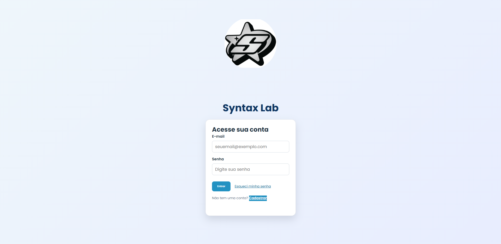

# Estrutura do Front-end

O front-end é composto por 11 páginas HTML, cada uma com uma finalidade específica dentro do sistema.

## 1. `index.html` — Cadastro inicial

Página inicial de cadastro de usuários.

O formulário inclui os seguintes campos:

- Nome completo;
- E-mail;
- Senha;
- Idade, com restrição para pessoas menores de 18 anos;
- Gênero.

A página foi planejada para permitir o preenchimento dos dados necessários ao cadastro e incluir uma restrição de idade mínima de 18 anos.

### página de cadastro

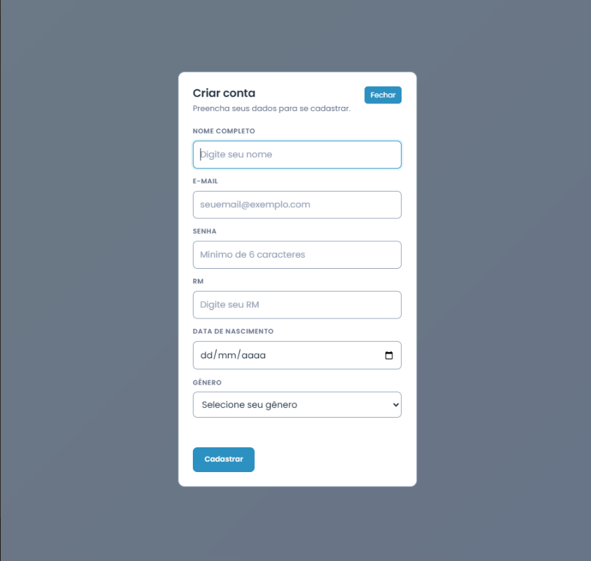

## 2. `inicio.html` — Página inicial do sistema

Apresenta o painel principal do SYNTAX.lab.

A tela contém indicadores das ordens de serviço e atalhos para acessar diferentes áreas do sistema, permitindo uma visualização resumida das informações.


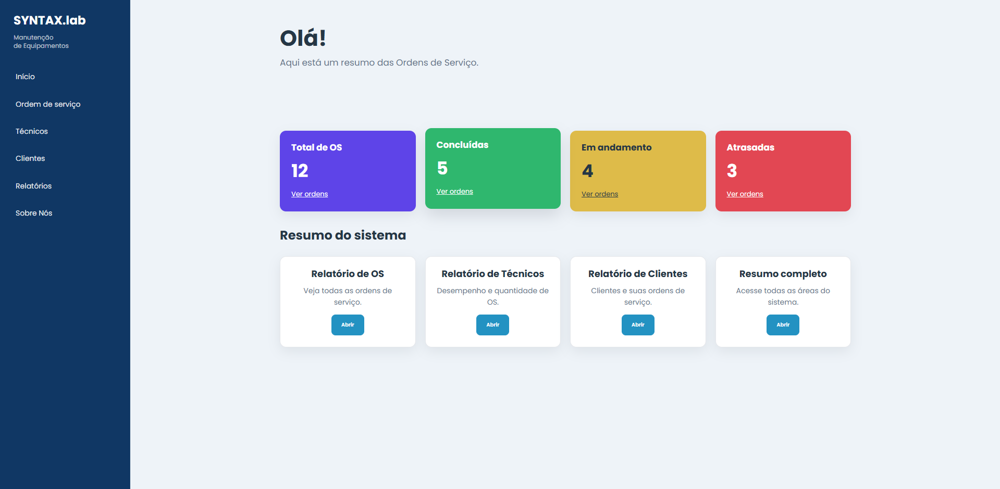

## 3. `cadascliente.html` — Cadastro de clientes

Página destinada ao preenchimento das informações dos clientes.

Seu objetivo é permitir o registro dos dados necessários para identificar e manter organizados os clientes atendidos pela empresa.


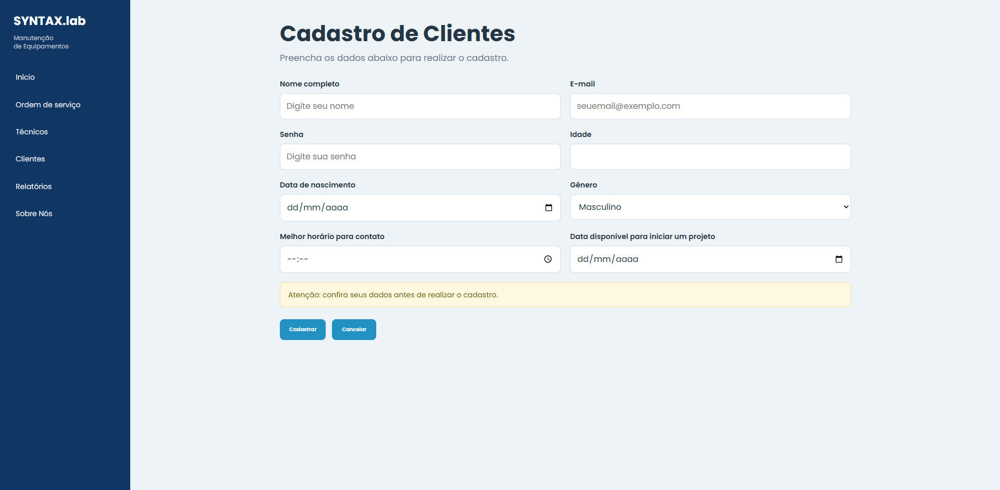

## 4. `clientes.html` — Gerenciamento de clientes

Página que apresenta os clientes já cadastrados no sistema.

Permite consultar os registros existentes e acessar as opções disponíveis para o gerenciamento dos dados dos clientes.


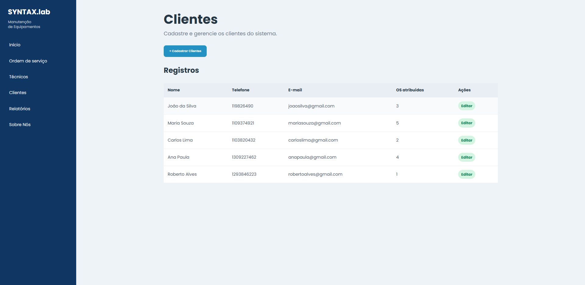

## 5. `cadastrar.html` — Cadastro de técnicos

Página destinada ao cadastro de técnicos que fazem parte da equipe de manutenção.

Os dados cadastrados ajudam a identificar os profissionais responsáveis pela realização dos serviços.


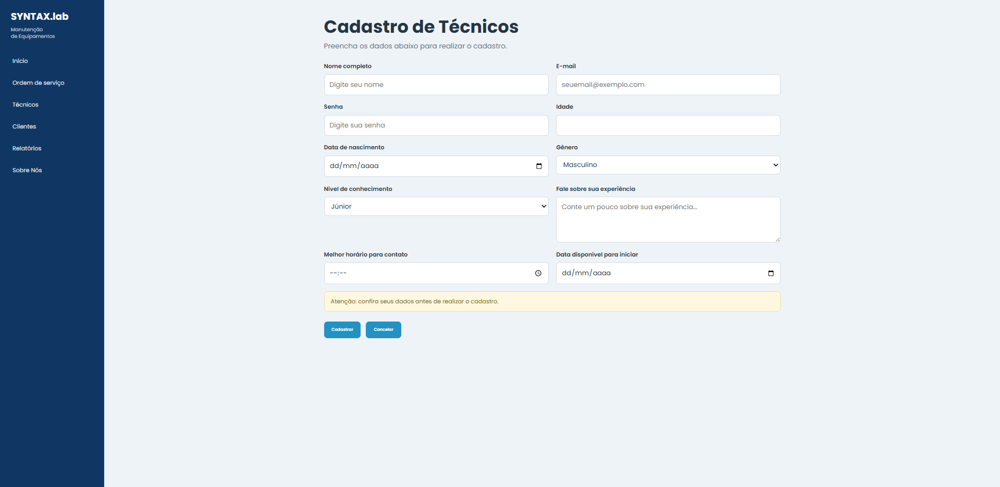

## 6. `tecnicos.html` — Gerenciamento de técnicos

Página utilizada para visualizar e gerenciar os técnicos cadastrados.

Também apresenta opções para acessar o cadastro e organizar as informações dos profissionais da equipe.


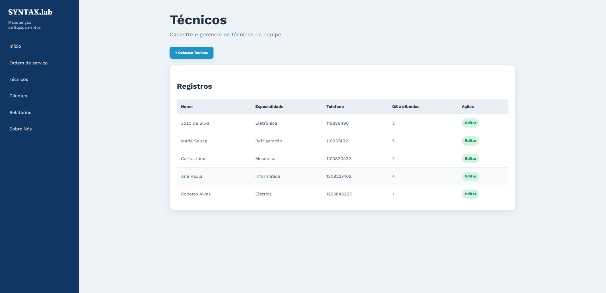

## 7. `editar.html` — Edição de cadastros

Página destinada à edição dos dados dos clientes já cadastrados.

Também permite acessar informações relacionadas aos problemas relatados nos equipamentos e atualizar os dados dos registros, conforme as funcionalidades implementadas no sistema.


 

## 8. `ordem.html` — Ordens de serviço

A página apresenta informações sobre as ordens de serviço e seus detalhes.

### O que é uma Ordem de Serviço?

A Ordem de Serviço (OS) é um documento utilizado para registrar, formalizar e acompanhar a realização de um serviço contratado.

Ela informa o que será feito, quem será responsável, quais são os prazos e quais materiais ou recursos serão necessários.

É utilizada em diferentes setores, como manutenção de equipamentos, oficinas, assistência técnica, tecnologia e prestação de serviços.

### Para que serve uma OS?

As principais funções de uma ordem de serviço são:

- **Formalizar o serviço:** registrar o que foi solicitado e acordado com o cliente.
- **Acompanhar o andamento:** identificar se o serviço está pendente, em execução ou concluído.
- **Organizar os custos:** registrar materiais, peças e mão de obra.
- **Controlar prazos:** acompanhar as datas de início e conclusão.
- **Facilitar a cobrança:** fornecer informações para o controle financeiro.
- **Evitar problemas:** manter um histórico do serviço e reduzir mal-entendidos entre a empresa e o cliente.

A página reúne os registros das ordens de serviço e permite consultar informações relacionadas aos clientes, equipamentos, técnicos, prazos e status dos serviços.


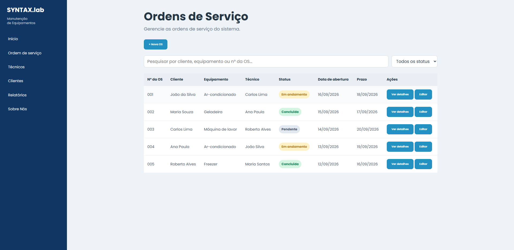


## 9. `detalhes.html` — Detalhes das ordens de serviço

Página destinada à apresentação dos detalhes dos registros relacionados às ordens de serviço.

Seu objetivo é facilitar a consulta das informações dos clientes e dos serviços registrados, reunindo dados que ajudam a compreender cada atendimento.


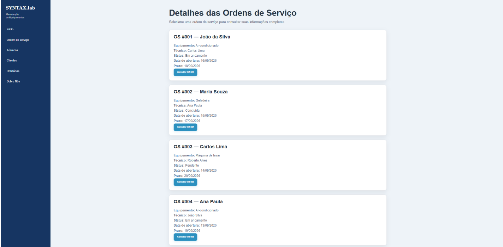

## 10. `relatorios.html` — Relatórios do sistema

Página que apresenta um resumo das informações disponíveis no sistema.

Os relatórios ajudam a visualizar os dados relacionados às ordens de serviço, aos técnicos e aos clientes, facilitando a consulta e a organização das informações.


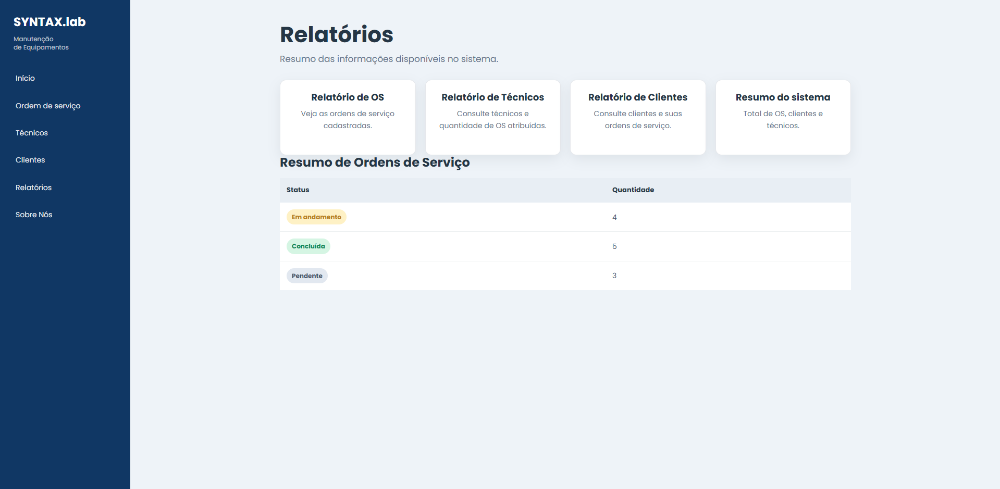

## 11. `sobre.html` — Sobre nós

Página destinada à apresentação dos integrantes do grupo e de suas respectivas funções no desenvolvimento do projeto.

Seu objetivo é identificar os participantes e apresentar a contribuição de cada integrante para a construção do SYNTAX.lab.


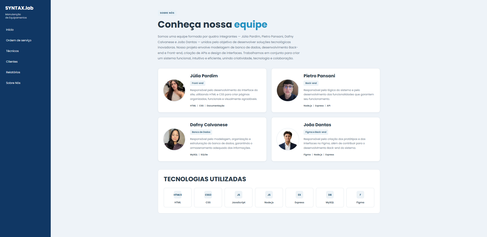

# Documentação do back-end — SYNTAX.lab (`server.js`)

Toda a API do sistema está em um único arquivo: **`server.js`** (Node.js + Express + SQLite). Este documento descreve o que esse arquivo oferece: endpoints, métodos HTTP, parâmetros e respostas.

## Como executar

Dependências usadas pelo `server.js`: `express`, `cors`, `sqlite3`, `bcryptjs`.

```bash
npm install express cors sqlite3 bcryptjs
node server.js
```

Ao iniciar com sucesso, o terminal mostra `SITE + BACK-END FUNCIONANDO` e o endereço `http://localhost:3000/index.html`.

## Informações gerais

| Item | Valor (conforme o `server.js`) |
|---|---|
| Endereço | `http://localhost:3000` (porta alterável pela variável de ambiente `PORT`) |
| Escuta em | `127.0.0.1`, ou seja, só o próprio computador acessa |
| Formato | JSON (`Content-Type: application/json`); formulários `urlencoded` também são lidos |
| Limite do corpo | 100 kb |
| Banco de dados | SQLite, arquivo `banco.db` na pasta **acima** da pasta do `server.js` (`path.join(__dirname, '..', 'banco.db')`) |
| Banco antigo | Se existir `banco.db` na mesma pasta do `server.js`, seus dados são mesclados no banco novo uma única vez (`migrarBancoAnterior`) |
| Autenticação | Nenhuma: não há token nem sessão em nenhuma rota |
| CORS | Liberado para qualquer origem |

Ao iniciar, o `prepararBanco()` cria as tabelas que não existirem e adiciona colunas ausentes, **sem apagar tabelas nem registros**. Ele também insere os status fixos.

---

## Sumário dos endpoints

| Seção do `server.js` | Método | Endpoint | Descrição |
|---|---|---|---|
| Usuários | POST | `/api/usuarios/cadastro` | Cadastra usuário da tela de entrada |
| Usuários | POST | `/api/usuarios/login` | Login de usuário |
| Clientes | POST | `/api/clientes` | Cria cliente |
| Clientes | GET | `/api/clientes` | Lista clientes |
| Clientes | PUT | `/api/clientes/:id` | Edita cliente |
| Clientes | DELETE | `/api/clientes/:id` | Exclui cliente |
| Técnicos | POST | `/api/tecnicos/cadastro` | Cadastra técnico |
| Técnicos | GET | `/api/tecnicos` | Lista técnicos |
| Técnicos | PUT | `/api/tecnicos/:id` | Edita técnico |
| Técnicos | DELETE | `/api/tecnicos/:id` | Exclui técnico |
| Técnicos | POST | `/api/tecnicos/login` | Login de técnico |
| Ordens de serviço | GET | `/api/ordens/opcoes` | Técnicos e status para os formulários |
| Ordens de serviço | GET | `/api/ordens` | Lista OS |
| Ordens de serviço | POST | `/api/ordens` | Cria OS |
| Ordens de serviço | PUT | `/api/ordens/:id` | Edita OS |
| Ordens de serviço | DELETE | `/api/ordens/:id` | Exclui OS |
| Ordens de serviço | PUT | `/api/ordens/:id/status` | Altera só o status da OS |
| Dashboard | GET | `/api/ordens/resumo` | Totais para `inicio.html` |
| Utilidade | GET | `/api/saude` | Confere API e banco |
| Front-end | GET | qualquer arquivo público | Entrega HTML, CSS, JS e imagens |

---

## Convenções

### Códigos de status

| Código | Significado | Quando ocorre |
|---|---|---|
| 200 | OK | Consulta, edição ou exclusão bem-sucedida |
| 201 | Created | Registro criado |
| 400 | Bad Request | Dado ausente ou inválido, JSON malformado |
| 401 | Unauthorized | E-mail ou senha incorretos no login |
| 404 | Not Found | Registro ou rota inexistente |
| 409 | Conflict | E-mail ou RM duplicado; exclusão bloqueada por vínculo |
| 500 | Internal Server Error | Erro inesperado |

### Respostas de erro

Todo erro da API tem o formato:

```json
{ "erro": "Mensagem descrevendo o problema." }
```

Erros tratados de forma geral pelo `server.js`:

| Situação | Código | Mensagem |
|---|---|---|
| JSON com sintaxe inválida | 400 | `JSON inválido.` |
| Rota que não existe | 404 | `Rota não encontrada: MÉTODO /caminho` |
| Violação de campo único não prevista (ex.: duas requisições simultâneas) | 409 | `Já existe um cadastro com esses dados.` |
| Qualquer outro erro | 500 | `Erro interno. Confira a mensagem no terminal.` |

### Formatos e valores aceitos

| Campo | Regra |
|---|---|
| Datas | `AAAA-MM-DD`; a data precisa existir no calendário (ex.: `2026-02-30` é rejeitada) |
| E-mail | Formato `a@b.c`, até 254 caracteres; é convertido para minúsculas |
| Senha | Mínimo 6 caracteres e máximo 72 bytes; é salva como hash bcrypt e nunca devolvida |
| Nome | Até 120 caracteres |
| `genero` | `Masculino`, `Feminino` ou `Prefiro_nao_dizer` |
| `nivel` (técnico) | `JÚNIOR`, `PLENO` ou `SÊNIOR` |
| `nivel_emergencia` (OS) | `Baixo`, `Médio` ou `Grave` |
| `id_status` | `1` = Em andamento, `2` = Concluída, `3` = Pendente |
| `:id` na URL | Inteiro maior que zero |

---

## Usuários (tela de entrada)

### POST `/api/usuarios/cadastro`

Cadastra um usuário. Não é um login; o HTML redireciona depois do sucesso.

**Corpo**

| Campo | Tipo | Obrigatório | Regras |
|---|---|---|---|
| `nome` | string | Sim | Até 120 caracteres |
| `email` | string | Sim | Válido e único |
| `senha` | string | Sim | 6 caracteres a 72 bytes |
| `rm` | string | Sim | Até 4 caracteres; único, sem diferenciar maiúsculas |
| `data_nascimento` | string | Sim | `AAAA-MM-DD`; não pode ser futura |
| `genero` | string | Sim | Valores permitidos |
| `idade` | number | Não | Inteiro de 18 a 99, se enviada |

**Respostas**

- `201`: `{ "mensagem": "Dados salvos com sucesso.", "id_usuario": 1 }`
- `400`: campo obrigatório ausente; e-mail, senha, data ou gênero inválidos; RM ausente ou com mais de 4 caracteres
- `409`: `Este e-mail já está cadastrado. Nenhum novo registro foi criado.` ou `Este RM já está cadastrado.`

### POST `/api/usuarios/login`

Confere e-mail e senha. Não gera token nem sessão.

**Corpo:** `email` (string, obrigatório) e `senha` (string, obrigatório).

**Respostas**

- `200`
  ```json
  {
    "mensagem": "Login realizado com sucesso.",
    "usuario": { "id_usuario": 1, "nome": "Maria Silva", "email": "maria@exemplo.com" }
  }
  ```
- `400`: e-mail ou senha ausentes (`E-mail e senha são obrigatórios.`) ou e-mail com formato inválido
- `401`: `E-mail ou senha incorretos.` (a mesma mensagem vale para e-mail inexistente e senha errada)

---

## Clientes

### POST `/api/clientes`

**Corpo**

| Campo | Tipo | Obrigatório | Regras |
|---|---|---|---|
| `nome` | string | Sim | Até 120 caracteres |
| `telefone` | string | Não | Até 40 caracteres |
| `email` | string | Não | Válido, até 254 caracteres |

**Respostas**

- `201`: `{ "mensagem": "Cliente cadastrado com sucesso.", "id_cliente": 5 }`
- `400`: `Informe um nome com até 120 caracteres.` ou `Confira o telefone e o e-mail informados.`

### GET `/api/clientes`

Lista os clientes por ordem de nome, com a quantidade de OS de cada um.

**Resposta 200**
```json
[
  {
    "id_cliente": 5,
    "nome": "Carlos Souza",
    "telefone": "11 99999-0000",
    "email": "carlos@exemplo.com",
    "os_atribuidas": 2
  }
]
```

### PUT `/api/clientes/:id`

Atualiza nome, telefone e e-mail. Os opcionais que não forem enviados passam a ficar vazios (NULL).

**Corpo:** igual ao `POST /api/clientes`.

**Respostas**

- `200`: `{ "mensagem": "Cliente atualizado com sucesso." }`
- `400`: `Identificador de cliente inválido.` ou dados inválidos
- `404`: `Cliente não encontrado.`

### DELETE `/api/clientes/:id`

**Respostas**

- `200`: `{ "mensagem": "Cliente excluído com sucesso." }`
- `400`: `Identificador de cliente inválido.`
- `404`: `Cliente não encontrado.`
- `409`: `Não é possível excluir este cliente enquanto houver OS vinculadas.`

---

## Técnicos

### POST `/api/tecnicos/cadastro`

**Corpo**

| Campo | Tipo | Obrigatório | Regras |
|---|---|---|---|
| `nome` | string | Sim | Até 120 caracteres |
| `email` | string | Sim | Válido; único entre técnicos |
| `senha` | string | Sim | 6 caracteres a 72 bytes |
| `idade` | number | Não | 18 a 99 |
| `data_nascimento` | string | Não | `AAAA-MM-DD`; não futura |
| `genero` | string | Não | Valores permitidos |
| `nivel` | string | Não | Gravado como enviado (a conferência do valor só ocorre na edição) |
| `bio` | string | Não | Experiência do técnico |
| `horario_contato` | string | Não | Texto livre |
| `data_disponivel` | string | Não | Gravada como enviada (a conferência só ocorre na edição) |

**Respostas**

- `201`: `{ "mensagem": "Técnico cadastrado com sucesso.", "id_tecnico": 3 }`
- `400`: dados obrigatórios ausentes ou inválidos
- `409`: `Este e-mail já está cadastrado como técnico.`

### GET `/api/tecnicos`

Lista os técnicos por ordem de nome, com a quantidade de OS de cada um. A senha (hash) não é retornada.

**Resposta 200**
```json
[
  {
    "id_tecnico": 3,
    "nome": "João Lima",
    "email": "joao@exemplo.com",
    "idade": 30,
    "data_nascimento": "1996-02-10",
    "genero": "Masculino",
    "nivel": "PLENO",
    "bio": "5 anos com redes e hardware.",
    "horario_contato": "08:00-17:00",
    "data_disponivel": "2026-11-05",
    "os_atribuidas": 4
  }
]
```

### PUT `/api/tecnicos/:id`

Atualiza o técnico. A senha é opcional: se não for enviada, a atual é mantida.

**Corpo**

| Campo | Tipo | Obrigatório | Regras |
|---|---|---|---|
| `nome` | string | Sim | Até 120 caracteres |
| `email` | string | Sim | Válido; não pode ser de outro técnico |
| `senha` | string | Não | Se enviada: 6 caracteres a 72 bytes |
| `idade` | number | Não | 18 a 99 |
| `data_nascimento` | string | Não | `AAAA-MM-DD` válida |
| `genero` | string | Não | Valores permitidos |
| `nivel` | string | Não | `JÚNIOR`, `PLENO` ou `SÊNIOR` |
| `bio` | string | Não | Até 1000 caracteres |
| `horario_contato` | string | Não | Até 30 caracteres |
| `data_disponivel` | string | Não | `AAAA-MM-DD` válida |

**Respostas**

- `200`: `{ "mensagem": "Técnico atualizado com sucesso." }`
- `400`: `Identificador de técnico inválido.` ou dados inválidos
- `404`: `Técnico não encontrado.`
- `409`: `Este e-mail já pertence a outro técnico.`

### DELETE `/api/tecnicos/:id`

**Respostas**

- `200`: `{ "mensagem": "Técnico excluído com sucesso." }`
- `400`: `Identificador de técnico inválido.`
- `404`: `Técnico não encontrado.`
- `409`: `Não é possível excluir este técnico enquanto houver OS atribuídas a ele.`

### POST `/api/tecnicos/login`

Login de técnicos. A tela de entrada **não** usa esta rota (ela usa `/api/usuarios/login`).

**Corpo:** `email` e `senha` (obrigatórios).

**Respostas**

- `200`
  ```json
  {
    "mensagem": "Login realizado com sucesso.",
    "tecnico": { "id_tecnico": 3, "nome": "João Lima", "email": "joao@exemplo.com" }
  }
  ```
- `400`: `E-mail e senha são obrigatórios.`
- `401`: `E-mail ou senha incorretos.` (também ocorre se o técnico não tiver senha cadastrada)

---

## Ordens de serviço (OS)

### GET `/api/ordens/opcoes`

Devolve os dados para preencher os campos de seleção do formulário.

**Resposta 200**
```json
{
  "tecnicos": [{ "id_tecnico": 3, "nome": "João Lima" }],
  "status": [
    { "id_status": 1, "descricao": "Em andamento" },
    { "id_status": 2, "descricao": "Concluída" },
    { "id_status": 3, "descricao": "Pendente" }
  ]
}
```

### GET `/api/ordens`

Lista todas as OS, da mais recente para a mais antiga, já com os nomes de cliente, equipamento, técnico e status.

**Resposta 200**
```json
[
  {
    "id_os": 10,
    "data_os": "2026-10-28",
    "descricao_problema": "Notebook não liga.",
    "nivel_emergencia": "Grave",
    "id_status": 1,
    "id_cliente": 5,
    "id_tecnico": 3,
    "id_equipamento": 7,
    "status": "Em andamento",
    "cliente": "Carlos Souza",
    "equipamento": "Notebook Dell",
    "tecnico": "João Lima"
  }
]
```

### POST `/api/ordens`

Cria uma OS. Cliente e equipamento chegam **pelo nome**: se já existirem (sem diferenciar maiúsculas), são reaproveitados; senão, são criados. O status inicial é sempre `1` (Em andamento) e não pode ser escolhido aqui. Tudo é gravado em uma transação.

**Corpo**

| Campo | Tipo | Obrigatório | Regras |
|---|---|---|---|
| `cliente` | string | Sim | Até 120 caracteres |
| `equipamento` | string | Sim | Até 120 caracteres |
| `descricao_problema` | string | Sim | Até 1000 caracteres |
| `data_os` | string | Sim | `AAAA-MM-DD` válida |
| `nivel_emergencia` | string | Sim | `Baixo`, `Médio` ou `Grave` |
| `id_tecnico` | number | Sim | Técnico existente |

**Exemplo**
```json
{
  "cliente": "Carlos Souza",
  "equipamento": "Notebook Dell",
  "descricao_problema": "Notebook não liga.",
  "data_os": "2026-10-30",
  "nivel_emergencia": "Grave",
  "id_tecnico": 3
}
```

**Respostas**

- `201`: `{ "mensagem": "Ordem de serviço criada com sucesso.", "id_os": 11 }`
- `400`: dado ausente ou inválido, ou `O técnico selecionado não existe.`

### PUT `/api/ordens/:id`

Edita a OS por completo, inclusive o status. Segue as mesmas regras de cliente e equipamento do `POST`, também em transação.

**Corpo:** os campos do `POST /api/ordens` e mais:

| Campo | Tipo | Obrigatório | Regras |
|---|---|---|---|
| `id_status` | number | Sim | `1`, `2` ou `3` |

**Respostas**

- `200`: `{ "mensagem": "Ordem de serviço atualizada com sucesso." }`
- `400`: `Identificador de OS inválido.`, dados inválidos ou técnico inexistente
- `404`: `Ordem de serviço não encontrada.`

### PUT `/api/ordens/:id/status`

Altera apenas o status.

**Corpo:** `{ "id_status": 2 }` (obrigatório; `1`, `2` ou `3`).

**Respostas**

- `200`: `{ "mensagem": "Status da OS atualizado com sucesso." }`
- `400`: `Identificador de OS inválido.` ou `Selecione um status válido.`
- `404`: `Ordem de serviço não encontrada.`

### DELETE `/api/ordens/:id`

**Respostas**

- `200`: `{ "mensagem": "Ordem de serviço excluída com sucesso." }`
- `400`: `Identificador de OS inválido.`
- `404`: `Ordem de serviço não encontrada.`

---

## Dashboard

### GET `/api/ordens/resumo`

Totais usados na tela `inicio.html`. As OS "atrasadas" são as de status `1` ou `3` com `data_os` anterior à data de hoje, calculada em UTC pelo servidor.

**Resposta 200**
```json
{ "total": 12, "concluidas": 5, "emAndamento": 4, "atrasadas": 2 }
```

---

## Utilidade

### GET `/api/saude`

Confere se a API e o banco respondem.

**Resposta 200:** `{ "api": "ok", "banco": "ok" }`

---

## Arquivos do front-end

O próprio `server.js` entrega o site. As páginas e os arquivos estáticos são servidos a partir da **mesma pasta do `server.js`**.

- Apenas requisições `GET` e `HEAD`.
- Extensões liberadas: `.html`, `.css`, `.js`, `.png`, `.jpg`, `.jpeg`, `.gif`, `.svg`, `.webp`, `.ico`, `.woff`, `.woff2`, `.ttf`.
- A página padrão é o `index.html` (`http://localhost:3000/index.html`).
- Ficam bloqueados (resultam em `404`): arquivos dentro de `node_modules`, arquivos que começam com ponto, extensões fora da lista e os nomes da lista `arquivosInternos` (`server.js`, `api.js`, `database.js`, `consulta.js`, `estrutura.js`, `validacao.js`, `erros.js`, `clientes.js`, `tecnicos.js`, `equipamentos.js`, `ordens.js`, `relatorios.js`, `usuarios.js`, `banco.js`, `pessoas.js`, `atualizar-banco.js`).
- O `banco.db` fica uma pasta acima, então não é acessível pelo navegador.
- Caminho com codificação inválida: `400` com o texto `Endereço inválido.`


## Exemplos com curl

```bash
# Conferir a API
curl http://localhost:3000/api/saude

# Criar um cliente
curl -X POST http://localhost:3000/api/clientes \
  -H "Content-Type: application/json" \
  -d '{"nome":"Carlos Souza","telefone":"11 99999-0000"}'

# Criar uma OS
curl -X POST http://localhost:3000/api/ordens \
  -H "Content-Type: application/json" \
  -d '{"cliente":"Carlos Souza","equipamento":"Notebook Dell","descricao_problema":"Notebook não liga.","data_os":"2026-10-30","nivel_emergencia":"Grave","id_tecnico":3}'

# Concluir uma OS
curl -X PUT http://localhost:3000/api/ordens/11/status \
  -H "Content-Type: application/json" \
  -d '{"id_status":2}'
```

---

## Limitações do `server.js` atual

- Sem autenticação: os logins só conferem e-mail e senha; nenhuma rota é protegida.
- CORS aberto para qualquer origem.
- Cliente e equipamento são identificados pelo nome; homônimos viram o mesmo registro.
- O "hoje" do resumo é calculado em UTC e pode divergir do horário de Brasília à noite.
- Não existem rotas para equipamentos nem consulta individual por id.

---

## Resultado da Sprint 2

| Entregável | Onde está / como verificar |
|---|---|
| Banco de dados funcionando | `banco.db` criado e atualizado ao iniciar (`prepararBanco` no `server.js`) |
| API funcionando | `node server.js`, depois `GET /api/saude` |
| CRUD de OS | `/api/ordens`: POST, GET, PUT, DELETE e `/status` |
| CRUD de técnicos | `/api/tecnicos`: cadastro, GET, PUT, DELETE |
| CRUD de clientes | `/api/clientes`: POST, GET, PUT, DELETE |
| Interfaces principais implementadas | Páginas HTML na mesma pasta do `server.js` (a equipe confirma) |
| API documentada | Este arquivo (`DOCUMENTACAO.md`) |
| Código versionado no Git | A confirmar: commit e push do projeto, incluindo este arquivo |

# Banco de dados

O projeto utiliza o arquivo `banco.db` para armazenar as informações do sistema.

A estrutura do banco de dados foi desenvolvida utilizando o Visual Studio Code (VS Code), com os comandos de criação e inserção de dados organizados no arquivo de seed.

O banco de dados possui cinco tabelas:

1. Clientes;
2. Equipamentos;
3. Técnicos;
4. Status;
5. Ordem de Serviço.

## Arquivo de seed

A seed contém os comandos utilizados para criar as cinco tabelas e inserir as informações iniciais em cada uma delas.

Ela permite definir a estrutura do banco de dados e preparar os registros necessários para o funcionamento e os testes do sistema.

## Arquivo `banco.db`

O arquivo `banco.db` contém o banco de dados com as cinco tabelas e suas respectivas informações.


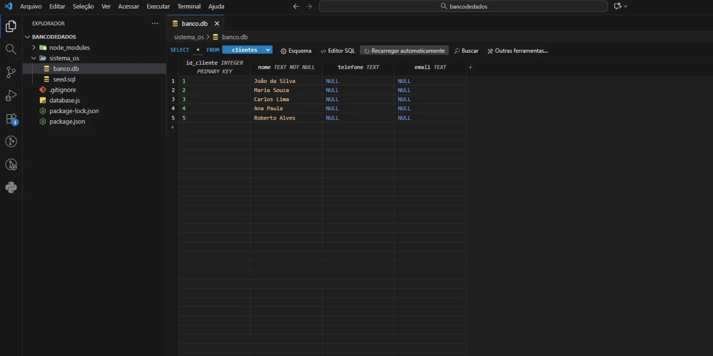


# Estrutura das tabelas

| Tabela | Colunas |
|---|---|
| `usuarios` | `id_usuario`, `nome`, `email` (único), `senha_hash`, `idade`, `data_nascimento`, `genero`, `rm` (índice único) |
| `tecnicos` | `id_tecnico`, `nome`, `email` (único), `senha_hash`, `idade`, `data_nascimento`, `genero`, `nivel`, `bio`, `horario_contato`, `data_disponivel` |
| `clientes` | `id_cliente`, `nome`, `telefone`, `email` |
| `equipamentos` | `id_equipamento`, `nome` |
| `status_os` | `id_status`, `descricao` (1 Em andamento, 2 Concluída, 3 Pendente) |
| `ordens_servico` | `id_os`, `descricao_problema`, `data_os`, `nivel_emergencia`, `id_cliente`, `id_tecnico`, `id_equipamento`, `id_status` (chaves estrangeiras) |
| `migracoes_banco` | `chave` (controle da migração do banco antigo) |


## 1. Tabela Clientes

Armazena as informações dos clientes cadastrados no sistema.

| Campo | Descrição |
|---|---|
| ID | Identificador único de cada registro. |
| Nome | Nome do cliente registrado. |
| Telefone | Telefone do cliente. |
| Email | E-mail pessoal do cliente. |

## 2. Tabela Equipamentos

Armazena os equipamentos registrados no sistema.

| Campo | Descrição |
|---|---|
| ID | Identificador único de cada registro. |
| Nome | Nome do equipamento registrado. |

## 3. Tabela Ordem de Serviço

Armazena as informações referentes aos problemas relatados e aos serviços solicitados.

| Campo | Descrição |
|---|---|
| ID | Identificador único de cada registro de ordem de serviço. |
| Descrição do problema | Descrição do problema apresentado pelo equipamento. |
| Data | Data em que o problema foi relatado. |

## 4. Tabela Status

Armazena os status utilizados para identificar a situação das ordens de serviço.

| Campo | Descrição |
|---|---|
| ID | Identificador único de cada registro. |
| Descrição | Situação da ordem de serviço, como pendente, em andamento ou concluída. |

## 5. Tabela Técnicos

Armazena as informações dos profissionais responsáveis pelos serviços de manutenção.

| Campo | Descrição |
|---|---|
| ID | Identificador único de cada técnico. |
| Nome | Nome do técnico registrado. |
| Especialidade | Área de conhecimento ou atuação do técnico. |
| Contato | Telefone ou e-mail do profissional para facilitar a comunicação. |


Adicione abaixo as capturas de tela das tabelas do banco de dados.

**Tabela Clientes**


**Tabela Equipamentos**

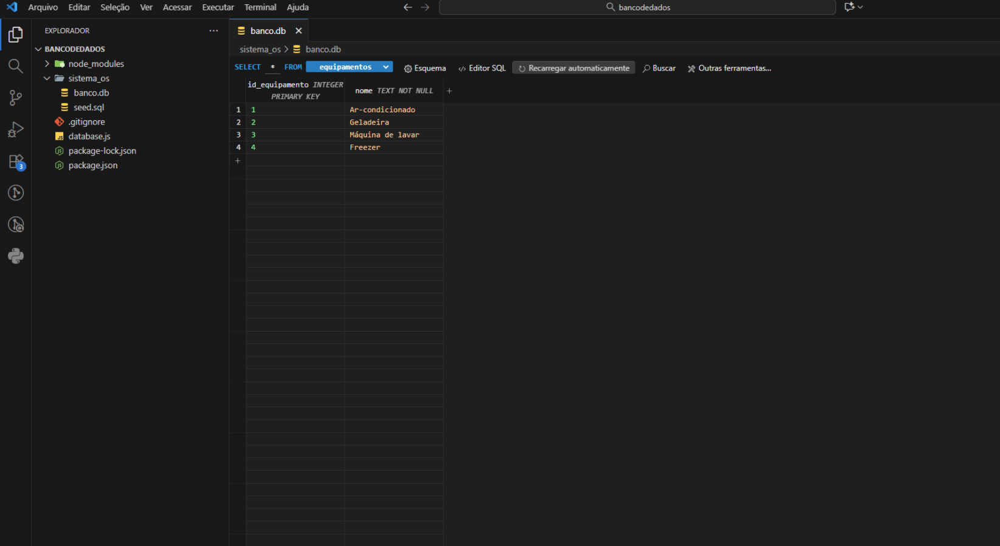

**Tabela Ordem de Serviço**

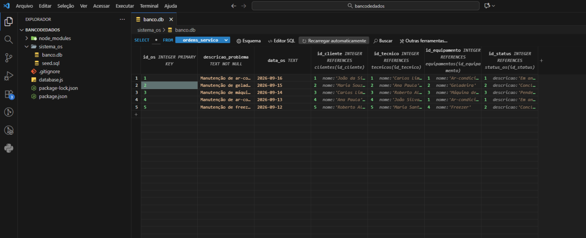

**Tabela Status**

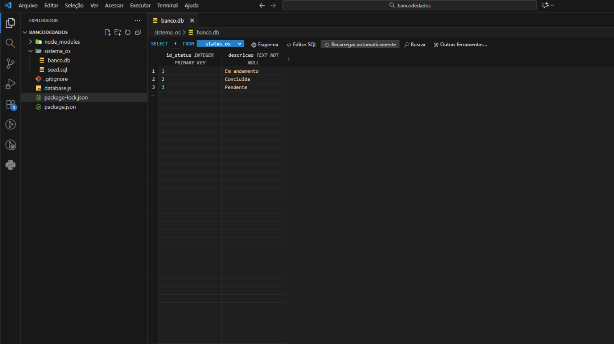

**Tabela Técnicos**

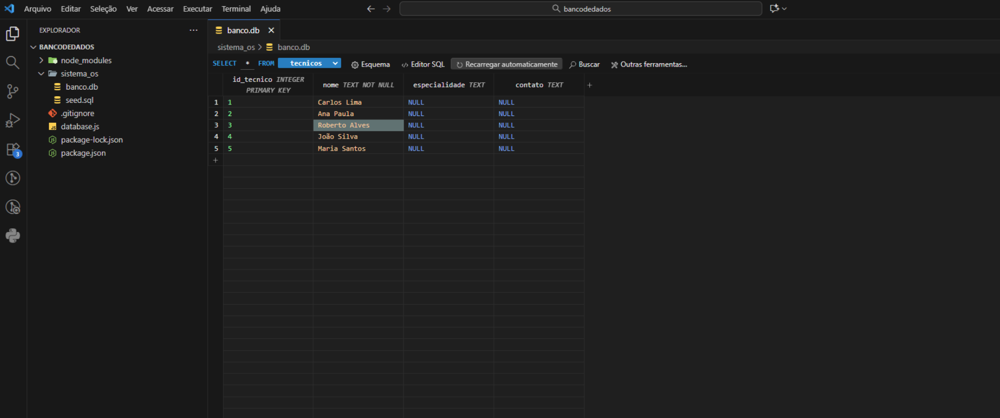


# Relacionamento entre as tabelas

As tabelas se relacionam por meio das ordens de serviço, que conectam os clientes, os técnicos, os equipamentos e os status.

Esses relacionamentos permitem organizar as informações de cada atendimento e manter os registros associados.

### Relacionamentos principais

- **Clientes → Ordens de Serviço:** um cliente pode ter várias ordens de serviço.
- **Técnicos → Ordens de Serviço:** um técnico pode ser responsável por várias ordens de serviço.
- **Equipamentos → Ordens de Serviço:** um equipamento pode estar associado a várias ordens de serviço.
- **Status → Ordens de Serviço:** cada ordem de serviço possui um status que indica sua situação, como pendente, em andamento ou concluída.


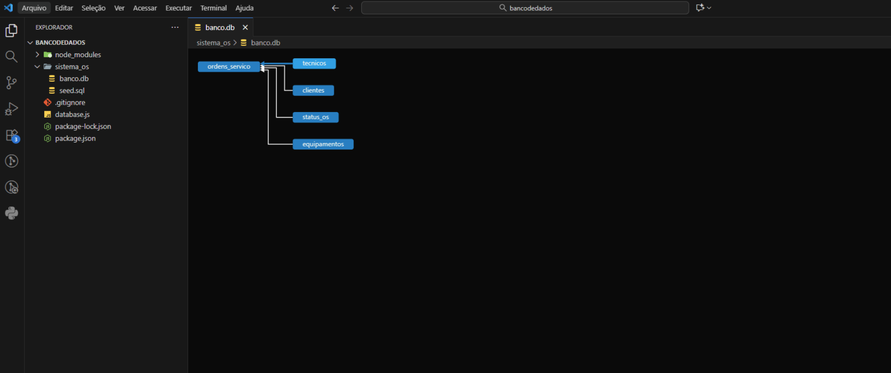


# Tecnologias e ferramentas

As ferramentas e tecnologias utilizadas no projeto incluem:

- **HTML:** estruturação das páginas do sistema.
- **CSS:** estilização e organização visual da interface.
- **Visual Studio Code (VS Code):** ambiente utilizado para desenvolver e organizar os arquivos do projeto.
- **Banco de dados SQLite (`banco.db`):** arquivo utilizado para armazenar os registros do sistema.

> A lista apresenta as tecnologias identificadas na estrutura descrita do projeto. Outras tecnologias podem ser acrescentadas caso também tenham sido utilizadas.


# Organização dos arquivos

Uma possível organização dos arquivos do projeto é:

## Organização dos arquivos

O projeto SYNTAX.lab está organizado em uma pasta principal, que contém o banco de dados e os arquivos de configuração. Dentro dela, a pasta `backend` reúne os arquivos HTML, CSS, JavaScript e demais recursos utilizados no sistema.

A estrutura atual do projeto está organizada da seguinte forma:

PROJETO-FALABELLA/
│
├── backend/
│   ├── IMG/
│   ├── node_modules/
│   │
│   ├── atualizar-banco.js
│   ├── banco.db
│   │
│   ├── cadascliente.html
│   ├── cadastrar.html
│   ├── cadastrarlogin.html
│   ├── cadastrarOS.html
│   ├── clientes.html
│   ├── editar.html
│   ├── index.html
│   ├── inicio.html
│   ├── ordem.html
│   ├── relatorios.html
│   ├── sobre.html
│   ├── tecnicos.html
│   │
│   ├── package.json
│   ├── package-lock.json
│   ├── README.md
│   ├── server.js
│   └── style.css
│
├── .gitignore
├── banco.db
├── package-lock.json
└── 
└── prints/
    ├── inicio.png
    ├── cadastro-inicial.png
    ├── cadascliente.png
    ├── clientes.png
    ├── cadastrar.png
    ├── tecnicos.png
    ├── editar.png
    ├── ordem.png
    ├── detalhes.png
    ├── relatorios.png
    ├── sobre.png
    ├── banco-de-dados.png
    ├── tabela-clientes.png
    ├── tabela-equipamentos.png
    ├── tabela-ordem-servico.png
    ├── tabela-status.png
    ├── tabela-tecnicos.png
    └── relacionamento-tabelas.png


### Descrição dos principais arquivos

- **backend/**: pasta que reúne os arquivos utilizados no funcionamento do sistema.
- **IMG/**: pasta destinada às imagens utilizadas nas páginas.
- **node_modules/**: pasta com as dependências instaladas pelo npm.
- **atualizar-banco.js**: arquivo utilizado para realizar atualizações relacionadas ao banco de dados.
- **banco.db**: banco de dados SQLite utilizado para armazenar as informações do sistema.
- **Arquivos HTML**: representam as páginas de cadastro, clientes, técnicos, edição, ordens de serviço, relatórios e outras funcionalidades.
- **style.css**: arquivo responsável pela estilização das páginas.
- **server.js**: arquivo principal do back-end, responsável pelo servidor e pelas rotas da API.
- **package.json**: contém as informações e os scripts de execução do projeto.
- **package-lock.json**: registra as versões específicas das dependências instaladas.
- **.gitignore**: define quais arquivos e pastas devem ser ignorados pelo Git.
- **README.md**: apresenta a documentação do projeto.

# Como visualizar o projeto

1. Abra a pasta do projeto no Visual Studio Code.
2. Verifique se os arquivos HTML, o CSS e os demais arquivos estão organizados nas pastas corretas.
3. Abra o arquivo `index.html` para visualizar a página de cadastro inicial.
4. Navegue pelas páginas por meio dos menus e dos links disponíveis.
5. Para visualizar o banco de dados, utilize uma ferramenta compatível com o formato SQLite.

A navegação e as funcionalidades disponíveis dependem dos links e dos recursos implementados nos arquivos do projeto.


# Equipe do projeto

O projeto foi desenvolvido em grupo. A página `sobre.html` apresenta os integrantes e suas respectivas funções.

**Integrantes:**

- **Nome:** [Júlia Pardim Vieira]
  - **Função:** [Responsável pelo Front End]

- **Nome:** [Dafny Calvanese]
  - **Função:** [Responsável pelo Banco de Dados]

- **Nome:** [João Dantas]
  - **Função:** [Responsável pelo FIGMA e Back End]

- **Nome:** [Pietro Pansani]
  - **Função:** [Responsável pelo Back End]

# Considerações finais

O SYNTAX.lab foi desenvolvido com o propósito de facilitar a organização das informações relacionadas à manutenção de equipamentos, reunindo cadastros, ordens de serviço, técnicos, clientes e relatórios em um único sistema.

O projeto também permitiu trabalhar com a estruturação de páginas web, a organização de arquivos, a modelagem de tabelas e o relacionamento entre dados em um banco de dados.

A documentação apresenta as principais páginas do front-end e a estrutura do banco de dados, contribuindo para a compreensão e a manutenção do projeto.
